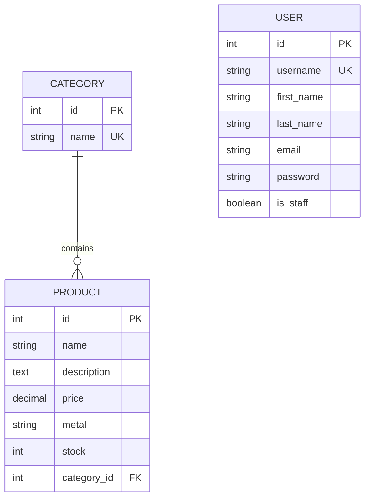

# Jewelry Store — онлайн-крамниця прикрас

Навчальний проєкт онлайн-крамниці ювелірних прикрас. Відвідувачі переглядають каталог і категорії, зареєстровані користувачі відкривають власний профіль, а адміністратори додають, редагують і видаляють товари та категорії.

## Технології

- Python 3.12, Django, Django REST Framework.
- SQLite та Django ORM.
- SimpleJWT для авторизації.
- django-cors-headers для запитів із фронтенду.
- pytest, pytest-django, pytest-cov для тестування.
- drf-spectacular і drf-spectacular-sidecar для OpenAPI та Swagger UI.
- python-decouple для налаштувань середовища.

Залежності для запуску й тестування містяться в `requirements.txt`.

## Як запустити проєкт

### 1. Завантажити код

```bash
git clone --branch feature/tests-docs https://github.com/nklefdd/web-programming-lab4.git
cd web-programming-lab4
python -m venv .venv
```

### 2. Активувати віртуальне середовище

Windows PowerShell:

```powershell
.\.venv\Scripts\Activate.ps1
```

Linux або macOS:

```bash
source .venv/bin/activate
```

Установити залежності:

```bash
python -m pip install -r requirements.txt
```

### 3. Підготувати `.env`

Скопіюйте `.env.example` у файл `.env` поруч із `manage.py`.

Згенеруйте власний секретний ключ:

```bash
python -c "import secrets; print(secrets.token_urlsafe(64))"
```

Вставте отримане значення після `SECRET_KEY=` у `.env`. Решту значень для локального запуску можна залишити з прикладу.

| Змінна | Призначення | Локальне значення |
| --- | --- | --- |
| `SECRET_KEY` | Ключ Django та підпису JWT | Власний згенерований ключ |
| `DEBUG` | Режим розробки | `True` |
| `ALLOWED_HOSTS` | Дозволені хости | `127.0.0.1,localhost` |
| `CORS_ALLOWED_ORIGINS` | Адреси фронтенду | `http://127.0.0.1:5500,http://localhost:5500` |
| `ACCESS_TOKEN_LIFETIME_MINUTES` | Тривалість access-токена у хвилинах | `5` |
| `REFRESH_TOKEN_LIFETIME_DAYS` | Тривалість refresh-токена у днях | `1` |
| `LOG_LEVEL` | Рівень логування застосунку | `INFO` |

Значення завантажуються через `python-decouple`. Змінні середовища мають пріоритет над `.env`.

Файл `.env` виключений із Git. Файл `.env.example` містить лише приклад налаштувань. SQLite не потребує пароля.

### 4. Створити базу даних та запустити сервер

```bash
python manage.py migrate
python manage.py createsuperuser
python manage.py runserver
```

- Бекенд: http://127.0.0.1:8000
- Каталог: http://127.0.0.1:8000/api/products
- Адмінпанель: http://127.0.0.1:8000/admin/
- Swagger UI: http://127.0.0.1:8000/api/docs

## Фронтенд і CORS

Фронтенд розміщений в окремому [репозиторії lab4-frontend](https://github.com/nklefdd/lab4-frontend). Версія з авторизацією міститься у гілці `auth-ui`; інструкція запуску — в її README.

Фронтенд працює на `http://127.0.0.1:5500`, бекенд — на `http://127.0.0.1:8000`.

CORS дозволяє запити з адрес, перелічених у `CORS_ALLOWED_ORIGINS`. Якщо порт фронтенду змінюється, потрібно оновити цю змінну в `.env` і перезапустити бекенд.

## Дані та бізнес-правила

- Категорія має унікальну назву до 100 символів.
- Товар належить одній категорії.
- Назва товару має до 200 символів, назва металу — до 50.
- Ціна має бути більшою за нуль.
- Кількість на складі — ціле невід’ємне число.
- Категорію з товарами видалити неможливо: спочатку потрібно видалити товари або перенести їх до іншої категорії.
- Облікові записи зберігаються у стандартній моделі Django `User`.
- Паролі зберігаються у вигляді хешів.

Схема основних таблиць реалізованого застосунку:



Міграції каталогу містяться в `shop/migrations`. Таблиці користувачів створюються стандартними міграціями Django.

## Правила API та доступ

Базова адреса: `http://127.0.0.1:8000/api`.

Адреси API не мають слеша в кінці. Тіла запитів і відповідей передаються у JSON. Для запитів із тілом використовується заголовок:

```http
Content-Type: application/json
```

Перегляд категорій і товарів доступний усім. Створення, редагування та видалення доступні користувачам з `is_staff=True`. Реєстрація створює звичайного користувача без прав адміністратора.

Для захищених запитів потрібно передати access-токен:

```http
Authorization: Bearer <access_token>
```

Відсутній токен у захищеному запиті повертає `401`. Звичайний користувач під час зміни каталогу отримує `403`.

Недійсний або прострочений токен повертає `401`, навіть якщо його передали для публічного перегляду каталогу.

Списки повертаються як JSON-масиви, упорядковані за `id`. Пошук, фільтрація та пагінація відсутні. `{id}` у URL — цілий ідентифікатор об’єкта. Запити GET і DELETE не мають тіла.

### Категорії

| Метод | Ендпоінт | Дія та успішна відповідь | Помилки |
| --- | --- | --- | --- |
| GET | `/api/categories` | Список категорій, `200` | `401` за недійсного токена |
| POST | `/api/categories` | Створена категорія, `201` | `400`, `401`, `403` |
| GET | `/api/categories/{id}` | Одна категорія, `200` | `401`, `404` |
| PUT | `/api/categories/{id}` | Оновлена категорія, `200` | `400`, `401`, `403`, `404` |
| DELETE | `/api/categories/{id}` | Видалення без тіла відповіді, `204` | `401`, `403`, `404`, `409` |

Тіло POST і PUT:

```json
{"name": "Каблучки"}
```

Об’єкт у відповіді GET, POST і PUT:

```json
{"id": 1, "name": "Каблучки"}
```

GET списку повертає масив таких об’єктів або `[]`.

### Товари

| Метод | Ендпоінт | Дія та успішна відповідь | Помилки |
| --- | --- | --- | --- |
| GET | `/api/products` | Список товарів, `200` | `401` за недійсного токена |
| POST | `/api/products` | Створений товар, `201` | `400`, `401`, `403` |
| GET | `/api/products/{id}` | Один товар, `200` | `401`, `404` |
| PUT | `/api/products/{id}` | Оновлений товар, `200` | `400`, `401`, `403`, `404` |
| DELETE | `/api/products/{id}` | Видалення без тіла відповіді, `204` | `401`, `403`, `404` |

Тіло POST і PUT:

```json
{
  "name": "Каблучка з діамантом",
  "description": "Біле золото",
  "price": "12500.00",
  "metal": "Золото",
  "stock": 5,
  "category": 1
}
```

Обов’язкові поля: `name`, `price`, `metal`, `category`. Категорія повинна існувати.

При створенні товару `description` за замовчуванням порожній, `stock` дорівнює `0`. Для PUT потрібно передавати всі обов’язкові поля.

Об’єкт у відповіді GET, POST і PUT:

```json
{
  "id": 1,
  "name": "Каблучка з діамантом",
  "description": "Біле золото",
  "price": "12500.00",
  "metal": "Золото",
  "stock": 5,
  "category": 1,
  "category_name": "Каблучки"
}
```

GET списку повертає масив таких об’єктів або `[]`.

Поля `id` і `category_name` доступні лише для читання. Ціна у відповідях передається рядком із двома десятковими знаками.

## Реєстрація та авторизація

### Реєстрація — POST `/api/auth/register`

Токен не потрібен.

```json
{
  "username": "olena",
  "first_name": "Олена",
  "last_name": "",
  "email": "olena@example.com",
  "password": "River!Amber872",
  "password_confirmation": "River!Amber872"
}
```

| Поле | Вимоги |
| --- | --- |
| `username` | Обов’язкове, унікальне, до 150 символів; літери, цифри та `@ . + - _` |
| `first_name`, `last_name` | Необов’язкові, до 150 символів |
| `email` | Обов’язкове, коректна адреса, до 254 символів |
| `password`, `password_confirmation` | Обов’язкові, 8–128 символів, повинні збігатися |

Поширені та повністю цифрові паролі відхиляються. Email не є унікальним; для входу використовується username.

Успішна відповідь `201`:

```json
{
  "id": 1,
  "username": "olena",
  "first_name": "Олена",
  "last_name": "",
  "email": "olena@example.com",
  "is_staff": false
}
```

Невалідні дані повертають `400` із помилками полів у `error.details`. Пароль і його підтвердження не повертаються у відповіді.

### Вхід — POST `/api/auth/login`

Токен не потрібен. Тіло запиту:

```json
{"username": "olena", "password": "River!Amber872"}
```

Відповідь `200`:

```json
{"access": "<access_token>", "refresh": "<refresh_token>"}
```

Відсутні поля повертають `400`, неправильні дані входу або неактивний акаунт — `401`.

### Оновлення токена — POST `/api/auth/refresh`

Access-токен у заголовку не потрібен. Тіло запиту:

```json
{"refresh": "<refresh_token>"}
```

Відповідь `200`:

```json
{"access": "<new_access_token>"}
```

Відсутнє поле `refresh` повертає `400`, недійсний або прострочений refresh-токен — `401`.

За замовчуванням access діє 5 хвилин, refresh — 1 день. Після завершення access фронтенд отримує новий токен через refresh і повторює запит. Refresh при цьому не змінюється та не подовжується. Якщо він прострочений, потрібен повторний вхід.

### Профіль — GET `/api/auth/me`

Потрібен заголовок `Authorization: Bearer <access_token>`. Тіло та query-параметри відсутні.

Відповідь `200` має ті самі поля користувача, що й відповідь реєстрації: `id`, `username`, `first_name`, `last_name`, `email`, `is_staff`.

Без дійсного токена повертається `401`.

### Вихід

Logout реалізований на фронтенді: access і refresh видаляються із `sessionStorage`. Окремого серверного ендпоінта немає. Видані токени залишаються чинними до завершення їхнього строку.

## Обробка помилок

API використовує спільний формат помилок. Приклад `400` для некоректної ціни:

```json
{
  "error": {
    "status": 400,
    "message": "Некоректні дані. Перевірте поля запиту.",
    "details": {
      "price": ["Ціна має бути більшою за 0."]
    }
  }
}
```

Приклад `403`:

```json
{
  "error": {
    "status": 403,
    "message": "Змінювати каталог може лише адміністратор."
  }
}
```

| Статус | Значення |
| --- | --- |
| `400` | Невалідні дані запиту |
| `401` | Потрібна автентифікація або токен недійсний |
| `403` | Користувач не має потрібних прав |
| `404` | Об’єкт із таким ID не знайдено |
| `409` | Категорія містить товари, тому видалення суперечить стану даних |

Для `409` повідомлення містить кількість товарів і вказівку спочатку видалити їх або перенести до іншої категорії.

## Тестування

Автоматизовані тести охоплюють один ресурс — товари (`/api/products`).

Перевіряються:

- список товарів і отримання одного товару;
- створення, оновлення та видалення адміністратором;
- відмова без авторизації (`401`) та без прав адміністратора (`403`);
- невалідні поля й відсутні обов’язкові значення (`400`);
- неіснуючий товар і повторне видалення (`404`);
- повний цикл створення, читання, оновлення та видалення;
- наявність шляхів товарів у схемі OpenAPI.

Тести містяться у `tests/test_products.py`. Фікстури у `tests/conftest.py` створюють користувачів, API-клієнти, категорії та товари.

Використовується окрема тестова база даних. Сервер для запуску тестів не потрібен; залежності та `.env` мають бути підготовлені за інструкцією вище.

Запуск тестів:

```bash
python -m pytest
```

Запуск із вимірюванням покриття:

```bash
python -m pytest --cov --cov-report=term-missing
```

Результат перевірки коміту `3bb3997`:

```text
38 passed

Name       Stmts   Miss   Cover
TOTAL        247     35     86%
```

Покриття вимірюється для коду проєкту за `.coveragerc`. Із підрахунку виключені тести, міграції, віртуальне середовище та службові файли запуску. Згенеровані файли coverage виключені з Git.

## OpenAPI та Swagger UI

Після запуску сервера доступні:

- [Swagger UI](http://127.0.0.1:8000/api/docs).
- [OpenAPI-схема у JSON](http://127.0.0.1:8000/api/schema?format=json).

Схема автоматично генерується через `drf-spectacular` для ресурсу товарів. Вона описує GET, POST, PUT, DELETE, параметр ID, тіла запитів, відповіді, статуси помилок і JWT-автентифікацію.

Для перевірки захищених операцій отримайте access-токен адміністратора через `/api/auth/login` і вставте його в поле `jwtAuth` кнопки **Authorize** у Swagger. Префікс `Bearer` додається автоматично.

Інтерфейс постачається пакетом `drf-spectacular-sidecar`. Для локального запуску через `runserver` використовується `DEBUG=True`.

## Логування

Повідомлення виводяться у термінал, де працює сервер.

| Рівень | Події |
| --- | --- |
| DEBUG | Отримання списку товарів та окремого товару |
| INFO | Створення, оновлення та видалення товару |
| WARNING | Спроба звернутися до неіснуючого товару або категорії |
| ERROR | Неочікувані помилки сервера через стандартне логування Django |

Додані повідомлення описують операцію та, де застосовно, ID об’єкта. Паролі, токени й тіла запитів у них не записуються.

Рівень логування застосунку задається через `LOG_LEVEL` у `.env`. Для повідомлень про читання встановіть `DEBUG` і перезапустіть сервер.

## Postman

Колекція формату v2.1 знаходиться у `postman/jewelry-api.postman_collection.json`.

1. Імпортуйте колекцію у Postman.
2. Задайте `base_url`: `http://127.0.0.1:8000/api`.
3. Заповніть `admin_username` і `admin_password` даними створеного адміністратора.
4. Запустіть колекцію по порядку через Collection Runner.

Колекція перевіряє реєстрацію, вхід, refresh, профіль, CRUD категорій і товарів та помилки 400, 401, 403, 404, 409.

Токени й ID створених об’єктів зберігаються у змінних автоматично. Тестовий користувач залишається в базі після виконання колекції.