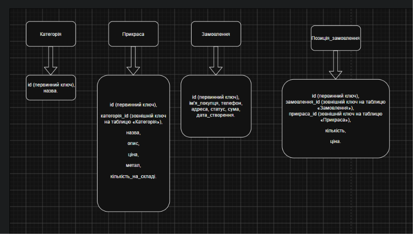

# Jewelry Store — онлайн-крамниця ювелірних прикрас

## Про що цей сайт

Це проста онлайн-крамниця ювелірних прикрас: каблучки, сережки, браслети, підвіски.

Ідея така: людина заходить на сайт, дивиться каталог, обирає прикраси за категорією або ціною і оформлює замовлення, вказавши своє ім'я, телефон і адресу.

### Що є на сайті

- **Категорії.** Каблучки, сережки, браслети тощо.
- **Прикраси.** У кожної є назва, опис, ціна, метал (золото, срібло), кількість на складі та категорія.
- **Замовлення.** Покупець обирає прикраси й кількість, залишає контакти. Замовлення має статус: нове, відправлене, доставлене або скасоване.
- **Адміністратор** додає, змінює й видаляє прикраси та змінює статуси замовлень.

> TODO: кошик і відгуки.
>
> Реалізовано: реєстрація, JWT-авторизація та права доступу.

### Що вже реалізовано

Категорії та прикраси (повний CRUD), реєстрація, вхід через JWT і профіль користувача. Замовлення, кошик і фільтри в списку прикрас поки лише описані нижче як план.

---

## Як запустити проєкт

Потрібен Python 3.12+. Команди виконуються в папці, де лежить `manage.py`.

```bash
python -m venv .venv
source .venv/bin/activate        # Windows: .venv\Scripts\activate
python -m pip install -r requirements.txt
python manage.py migrate
python manage.py createsuperuser
python manage.py runserver
```

- Бекенд: `http://127.0.0.1:8000`, API: `http://127.0.0.1:8000/api`
- Фронтенд ([lab4-frontend](https://github.com/nklefdd/lab4-frontend)): `http://127.0.0.1:5500`

### CORS

Налаштований через `django-cors-headers`. Дозволені джерела: `http://127.0.0.1:5500` та `http://localhost:5500` (`CORS_ALLOWED_ORIGINS` у `config/settings.py`). Якщо фронтенд працює на іншому порту, додайте його туди.

### Postman

Колекція: `postman/jewelry-api.postman_collection.json` (v2.1). Адреса сервера лежить у змінній `base_url`. Перед запуском задайте `admin_username` і `admin_password`. Запускайте запити по порядку: вони зберігають токени, `category_id` і `product_id`. Є приклади успішних запитів і помилок 400, 401, 403, 404, 409.

---

## Схема бази даних



---

## REST API

Загальні правила:

- Дані передаються у форматі JSON.
- Префікс усіх адрес: `/api`. Адреси без слеша в кінці.
- Помилки APIView мають однаковий формат:

```json
{
  "error": {
    "status": 409,
    "message": "Неможливо видалити категорію «Каблучки», оскільки в ній є прикраси: 3. Спочатку видаліть їх або перенесіть в іншу категорію."
  }
}
```

Для `400` додається ще поле `details` з помилками по полях.

### Які статуси помилок і чому

- `400 Bad Request` — невалідні дані (порожня назва, ціна ≤ 0, неіснуюча категорія, дубль назви категорії). Помилка у самому запиті, клієнт має його виправити.
- `404 Not Found` — об'єкта з таким `id` немає.
- `409 Conflict` — видалення категорії, в якій є прикраси. Запит правильний і об'єкт існує, але операція суперечить поточному стану даних, тому це не `400`. Виправляється видаленням або перенесенням прикрас.

### Категорії

#### Список категорій

- **Навіщо:** показати меню категорій.
- **Метод:** `GET /api/categories`
- **Request body:** немає
- **Response:** `200 OK`. Список категорій, у кожної є `id` і `name`.

#### Створити категорію

- **Навіщо:** адміністратор додає нову категорію.
- **Метод:** `POST /api/categories`
- **Request body:** `name` (назва, унікальна).
- **Response:** `201 Created`. Створена категорія з `id` і `name`.
- Якщо немає назви або вона вже існує: `400 Bad Request`.

#### Одна категорія

- **Навіщо:** подивитись категорію за `id`.
- **Метод:** `GET /api/categories/{id}`
- **Request body:** немає
- **Response:** `200 OK`. Категорія з `id` і `name`.
- Якщо немає: `404 Not Found`.

#### Змінити категорію

- **Навіщо:** перейменувати категорію.
- **Метод:** `PUT /api/categories/{id}`
- **Request body:** `name`.
- **Response:** `200 OK`. Оновлена категорія.
- Якщо дані неправильні: `400 Bad Request`. Якщо немає: `404 Not Found`.

#### Видалити категорію

- **Навіщо:** прибрати непотрібну категорію.
- **Метод:** `DELETE /api/categories/{id}`
- **Request body:** немає
- **Response:** `204 No Content`.
- Якщо немає: `404 Not Found`.
- Якщо в категорії є прикраси: `409 Conflict` з повідомленням, скільки їх.

---

### Прикраси

#### Список прикрас

- **Навіщо:** каталог.
- **Метод:** `GET /api/products`
- **Request body:** немає
- **Response:** `200 OK`. Список прикрас, у кожної є `id`, `name`, `description`, `price`, `metal`, `stock`, `category` (id категорії) і `category_name`.

> TODO: фільтри `category` (id категорії) і `max_price` (максимальна ціна), наприклад `GET /api/products?category=1&max_price=20000`. Поки не реалізовано.

#### Одна прикраса

- **Навіщо:** сторінка товару.
- **Метод:** `GET /api/products/{id}`
- **Request body:** немає
- **Response:** `200 OK`. Прикраса з полями `id`, `name`, `description`, `price`, `metal`, `stock`, `category`, `category_name`.
- Якщо немає: `404 Not Found`.

#### Додати прикрасу

- **Навіщо:** адміністратор додає товар.
- **Метод:** `POST /api/products`
- **Request body:** `name`, `price` (більше 0), `metal`, `category` (id категорії). Необов'язкові: `description`, `stock` (за замовчуванням 0).
- **Response:** `201 Created`. Створена прикраса з `id`.
- Якщо дані неправильні: `400 Bad Request`.

#### Змінити прикрасу

- **Навіщо:** змінити ціну, опис або кількість на складі.
- **Метод:** `PUT /api/products/{id}`
- **Request body:** ті самі поля, що й при створенні (обов'язкові поля передаються повністю).
- **Response:** `200 OK`. Оновлена прикраса.
- Якщо дані неправильні: `400 Bad Request`. Якщо немає: `404 Not Found`.

> TODO: `PATCH` для часткової зміни (тільки `price` і `stock`).

#### Видалити прикрасу

- **Навіщо:** прибрати товар з каталогу.
- **Метод:** `DELETE /api/products/{id}`
- **Request body:** немає
- **Response:** `204 No Content`.
- Якщо немає: `404 Not Found`.

---

### Замовлення

> Ще не реалізовано, буде в наступних роботах.

#### Створити замовлення

- **Навіщо:** покупець оформлює замовлення.
- **Метод:** `POST /api/orders`
- **Request body:**
  - `customer_name` — ім'я покупця
  - `phone` — телефон
  - `address` — адреса доставки
  - `items` — список прикрас, у кожної є `product_id` і `quantity`
- **Response:** `201 Created`. Створене замовлення з `id`, `status` (спочатку `new`), `total` (загальна сума) і `customer_name`.
- Якщо список `items` порожній або товару немає на складі: `400 Bad Request`.

> TBD: оплата. (спробувати тестовий api liqpay або іншого сервіса з оплатою, або взагалі поки робити без оплати (?))

#### Список замовлень

- **Навіщо:** адміністратор бачить усі замовлення.
- **Метод:** `GET /api/orders`
- **Request body:** немає
- **Response:** `200 OK`. Список замовлень, у кожного є `id`, `status`, `total`, `customer_name`.

#### Одне замовлення

- **Навіщо:** подивитись деталі замовлення.
- **Метод:** `GET /api/orders/{id}`
- **Request body:** немає
- **Response:** `200 OK`. Замовлення з полями `id`, `status`, `total`, `customer_name`, `phone`, `address` і `items`. У кожної прикраси в `items` є `product_id`, `name`, `price`, `quantity`.
- Якщо немає: `404 Not Found`.

#### Змінити статус замовлення

- **Навіщо:** адміністратор відмічає, що замовлення відправлене чи доставлене, або скасовує його.
- **Метод:** `PATCH /api/orders/{id}`
- **Request body:** `status`. Можливі значення: `new`, `shipped`, `delivered`, `cancelled`.
- **Response:** `200 OK`. Оновлене замовлення.
- Якщо статус неправильний: `400 Bad Request`. Якщо замовлення немає: `404 Not Found`.

## Реєстрація, JWT та права доступу

Новий код знаходиться в app `accounts`. Використовується стандартна модель `django.contrib.auth.models.User`, тому окрема міграція для `accounts` не потрібна: таблиці користувачів створює `python manage.py migrate` через стандартні міграції Django. Існуючі моделі та міграції каталогу збережені.

Для адміністратора виконайте `python manage.py createsuperuser`. Користувач, створений через реєстрацію, завжди звичайний, без `is_staff`. Адміністратор для API — користувач з `is_staff=True`.

### Доступ

| Ендпоінти | Метод | Хто має доступ |
| --- | --- | --- |
| `/api/categories`, `/api/products` | GET | Усі |
| `/api/categories/{id}`, `/api/products/{id}` | GET | Усі |
| `/api/categories`, `/api/products` | POST | Адміністратор |
| `/api/categories/{id}`, `/api/products/{id}` | PUT, DELETE | Адміністратор |
| `/api/auth/register`, `/api/auth/login`, `/api/auth/refresh` | POST | Без access-токена |
| `/api/auth/me` | GET | Авторизований користувач |

Для закритих запитів передайте хедер `Authorization: Bearer <access>`. Для JSON-запитів — `Content-Type: application/json`. URL без слеша в кінці. Query-параметрів у нових ендпоінтів немає.

Запит без токена або з недійсним/простроченим токеном повертає **401**. Звичайний авторизований користувач при зміні каталогу отримує **403**, бо його роль не дозволяє дію. Попередні статуси CRUD (200, 201, 204, 400, 404, 409) залишаються чинними після перевірки доступу.

### POST /api/auth/register

Обов’язкові поля: `username`, `email`, `password`, `password_confirmation`. `first_name` і `last_name` необов’язкові, за замовчуванням порожні.

| Поле | Обмеження |
| --- | --- |
| username | 1–150 символів; унікальне; літери, цифри та @/./+/-/_ |
| first_name, last_name | До 150 символів |
| email | До 254 символів; коректна email-адреса; не використовується для входу |
| password, password_confirmation | 8–128 символів; значення повинні збігатися |

Додатково Django відхиляє поширені та лише цифрові паролі. Пароль зберігається через `create_user()` у вигляді хешу, у відповідь не повертається. Email не є унікальним; унікальний ідентифікатор входу — username.

Request:
```json
{"username":"olena","first_name":"Олена","last_name":"","email":"olena@example.com","password":"River!Amber872","password_confirmation":"River!Amber872"}
```

Response **201**:
```json
{"id":1,"username":"olena","first_name":"Олена","last_name":"","email":"olena@example.com","is_staff":false}
```

Response **400** для невалідних полів, зайнятого username або різних паролів:
```json
{"error":{"status":400,"message":"Некоректні дані. Перевірте поля запиту.","details":{"password_confirmation":["Паролі не збігаються."]}}}
```

У `details` ключі відповідають полям форми, значення — списки помилок. Спочатку перевіряються окремі поля, а після цього — збіг паролів.

### POST /api/auth/login

Request:
```json
{"username":"olena","password":"River!Amber872"}
```

Response **200**:
```json
{"refresh":"<refresh JWT>","access":"<access JWT>"}
```

Статуси: **400** — не заповнені поля, **401** — неправильні дані входу або неактивний акаунт. Access діє 5 хвилин, refresh — 1 день.

### POST /api/auth/refresh

Request:
```json
{"refresh":"<refresh JWT>"}
```

Response **200**:
```json
{"access":"<новий access JWT>"}
```

Статуси: **400** — відсутнє поле refresh, **401** — токен недійсний або прострочений. Refresh-токен не змінюється та не подовжується. Фронтенд після 401 на захищеному запиті отримує новий access і повторює початковий запит один раз. Якщо refresh теж завершився, потрібно ввійти знову.

### GET /api/auth/me

Header: `Authorization: Bearer <access>`. Request body відсутнє.

Response **200**:
```json
{"id":1,"username":"olena","first_name":"Олена","last_name":"","email":"olena@example.com","is_staff":false}
```

Response **401**:
```json
{"error":{"status":401,"message":"Потрібно увійти в акаунт. Перевірте логін і пароль або оновіть токен."}}
```

Приклад **403** при спробі звичайного користувача змінити каталог:
```json
{"error":{"status":403,"message":"Змінювати каталог може лише адміністратор."}}
```

### Logout

Окремого серверного ендпоінта немає: кнопка виходу видаляє access і refresh із `sessionStorage` та відкриває каталог. Це клієнтський logout за умовою роботи. Уже виданий токен не відкликається на сервері й залишається чинним до завершення свого строку.

### Перевірка

Postman: імпортуйте `postman/jewelry-api.postman_collection.json`, задайте `admin_username` та `admin_password` користувача, створеного командою `createsuperuser`. `base_url` за замовчуванням дорівнює `http://127.0.0.1:8000/api`. Запустіть усю колекцію по порядку. Вона створить тестового користувача з унікальним username, перевірить реєстрацію, логін, refresh, профіль, 400/401/403, потім увійде як адміністратор і виконає попередні CRUD-сценарії, включно з 409. Каталог тестові запити прибирають; тестовий користувач залишається у БД. Змінні токенів заповнюються автоматично.

Проєкт призначений для локального запуску. Перед розгортанням потрібно замінити навчальний SECRET_KEY і вимкнути DEBUG. Реалізація JWT використовує [SimpleJWT](https://django-rest-framework-simplejwt.readthedocs.io/en/stable/getting_started.html).
