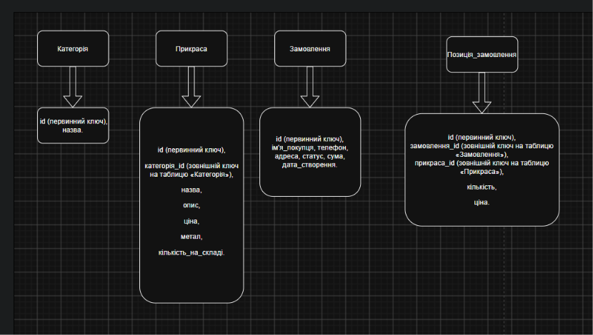

# Jewelry Store — онлайн-крамниця ювелірних прикрас

## Про що цей сайт

Це проста онлайн-крамниця ювелірних прикрас: каблучки, сережки, браслети, підвіски.

Ідея така: людина заходить на сайт, дивиться каталог, обирає прикраси за категорією або ціною і оформлює замовлення, вказавши своє ім'я, телефон і адресу.

### Що є на сайті

- **Категорії.** Каблучки, сережки, браслети тощо.
- **Прикраси.** У кожної є назва, опис, ціна, метал (золото, срібло), кількість на складі та категорія.
- **Замовлення.** Покупець обирає прикраси й кількість, залишає контакти. Замовлення має статус: нове, відправлене, доставлене або скасоване.
- **Адміністратор** додає, змінює й видаляє прикраси та змінює статуси замовлень.

> TODO: реєстрація, вхід(пошта або\і номер(?)), кошик і відгуки.
>
> TODO: авторизація і права доступу.

### Що вже реалізовано

Категорії та прикраси (повний CRUD). Замовлення, авторизація, кошик і фільтри в списку прикрас поки лише описані нижче як план.

---

## Як запустити проєкт

Потрібен Python 3.12+. Команди виконуються в папці, де лежить `manage.py`.

```bash
python -m venv .venv
source .venv/bin/activate        # Windows: .venv\Scripts\activate
python -m pip install -r requirements.txt
python manage.py migrate
python manage.py runserver
```

- Бекенд: `http://127.0.0.1:8000`, API: `http://127.0.0.1:8000/api`
- Фронтенд (окремий репозиторій: _посилання_): `http://127.0.0.1:5500`

### CORS

Налаштований через `django-cors-headers`. Дозволені джерела: `http://127.0.0.1:5500` та `http://localhost:5500` (`CORS_ALLOWED_ORIGINS` у `config/settings.py`). Якщо фронтенд працює на іншому порту, додайте його туди.

### Postman

Колекція: `postman/jewelry-api.postman_collection.json` (v2.1). Адреса сервера лежить у змінній `base_url`. Запити краще запускати по порядку, вони залежать від `category_id` і `product_id`. Є приклади успішних запитів і помилок 400, 404, 409.

---

## Схема бази даних



---

## REST API

Загальні правила:

- Дані передаються у форматі JSON.
- Префікс усіх адрес: `/api`. Адреси без слеша в кінці.
- Усі помилки мають однаковий формат:

```json
{
  "error": {
    "status": 409,
    "message": "Неможливо видалити категорію «Каблучки», оскільки в ній є прикраси: 3. Спочатку видаліть їх або перенесіть в іншу категорію."
  }
}
```

Для `400` додається ще поле `details` з помилками по полях.

### Які статуси помилок і чому

- `400 Bad Request` — невалідні дані (порожня назва, ціна ≤ 0, неіснуюча категорія, дубль назви категорії). Помилка у самому запиті, клієнт має його виправити.
- `404 Not Found` — об'єкта з таким `id` немає.
- `409 Conflict` — видалення категорії, в якій є прикраси. Запит правильний і об'єкт існує, але операція суперечить поточному стану даних, тому це не `400`. Виправляється видаленням або перенесенням прикрас.

### Категорії

#### Список категорій

- **Навіщо:** показати меню категорій.
- **Метод:** `GET /api/categories`
- **Request body:** немає
- **Response:** `200 OK`. Список категорій, у кожної є `id` і `name`.

#### Створити категорію

- **Навіщо:** адміністратор додає нову категорію.
- **Метод:** `POST /api/categories`
- **Request body:** `name` (назва, унікальна).
- **Response:** `201 Created`. Створена категорія з `id` і `name`.
- Якщо немає назви або вона вже існує: `400 Bad Request`.

#### Одна категорія

- **Навіщо:** подивитись категорію за `id`.
- **Метод:** `GET /api/categories/{id}`
- **Request body:** немає
- **Response:** `200 OK`. Категорія з `id` і `name`.
- Якщо немає: `404 Not Found`.

#### Змінити категорію

- **Навіщо:** перейменувати категорію.
- **Метод:** `PUT /api/categories/{id}`
- **Request body:** `name`.
- **Response:** `200 OK`. Оновлена категорія.
- Якщо дані неправильні: `400 Bad Request`. Якщо немає: `404 Not Found`.

#### Видалити категорію

- **Навіщо:** прибрати непотрібну категорію.
- **Метод:** `DELETE /api/categories/{id}`
- **Request body:** немає
- **Response:** `204 No Content`.
- Якщо немає: `404 Not Found`.
- Якщо в категорії є прикраси: `409 Conflict` з повідомленням, скільки їх.

---

### Прикраси

#### Список прикрас

- **Навіщо:** каталог.
- **Метод:** `GET /api/products`
- **Request body:** немає
- **Response:** `200 OK`. Список прикрас, у кожної є `id`, `name`, `description`, `price`, `metal`, `stock`, `category` (id категорії) і `category_name`.

> TODO: фільтри `category` (id категорії) і `max_price` (максимальна ціна), наприклад `GET /api/products?category=1&max_price=20000`. Поки не реалізовано.

#### Одна прикраса

- **Навіщо:** сторінка товару.
- **Метод:** `GET /api/products/{id}`
- **Request body:** немає
- **Response:** `200 OK`. Прикраса з полями `id`, `name`, `description`, `price`, `metal`, `stock`, `category`, `category_name`.
- Якщо немає: `404 Not Found`.

#### Додати прикрасу

- **Навіщо:** адміністратор додає товар.
- **Метод:** `POST /api/products`
- **Request body:** `name`, `price` (більше 0), `metal`, `category` (id категорії). Необов'язкові: `description`, `stock` (за замовчуванням 0).
- **Response:** `201 Created`. Створена прикраса з `id`.
- Якщо дані неправильні: `400 Bad Request`.

#### Змінити прикрасу

- **Навіщо:** змінити ціну, опис або кількість на складі.
- **Метод:** `PUT /api/products/{id}`
- **Request body:** ті самі поля, що й при створенні (обов'язкові поля передаються повністю).
- **Response:** `200 OK`. Оновлена прикраса.
- Якщо дані неправильні: `400 Bad Request`. Якщо немає: `404 Not Found`.

> TODO: `PATCH` для часткової зміни (тільки `price` і `stock`).

#### Видалити прикрасу

- **Навіщо:** прибрати товар з каталогу.
- **Метод:** `DELETE /api/products/{id}`
- **Request body:** немає
- **Response:** `204 No Content`.
- Якщо немає: `404 Not Found`.

---

### Замовлення

> Ще не реалізовано, буде в наступних роботах.

#### Створити замовлення

- **Навіщо:** покупець оформлює замовлення.
- **Метод:** `POST /api/orders`
- **Request body:**
  - `customer_name` — ім'я покупця
  - `phone` — телефон
  - `address` — адреса доставки
  - `items` — список прикрас, у кожної є `product_id` і `quantity`
- **Response:** `201 Created`. Створене замовлення з `id`, `status` (спочатку `new`), `total` (загальна сума) і `customer_name`.
- Якщо список `items` порожній або товару немає на складі: `400 Bad Request`.

> TBD: оплата. (спробувати тестовий api liqpay або іншого сервіса з оплатою, або взагалі поки робити без оплати (?))

#### Список замовлень

- **Навіщо:** адміністратор бачить усі замовлення.
- **Метод:** `GET /api/orders`
- **Request body:** немає
- **Response:** `200 OK`. Список замовлень, у кожного є `id`, `status`, `total`, `customer_name`.

#### Одне замовлення

- **Навіщо:** подивитись деталі замовлення.
- **Метод:** `GET /api/orders/{id}`
- **Request body:** немає
- **Response:** `200 OK`. Замовлення з полями `id`, `status`, `total`, `customer_name`, `phone`, `address` і `items`. У кожної прикраси в `items` є `product_id`, `name`, `price`, `quantity`.
- Якщо немає: `404 Not Found`.

#### Змінити статус замовлення

- **Навіщо:** адміністратор відмічає, що замовлення відправлене чи доставлене, або скасовує його.
- **Метод:** `PATCH /api/orders/{id}`
- **Request body:** `status`. Можливі значення: `new`, `shipped`, `delivered`, `cancelled`.
- **Response:** `200 OK`. Оновлене замовлення.
- Якщо статус неправильний: `400 Bad Request`. Якщо замовлення немає: `404 Not Found`.